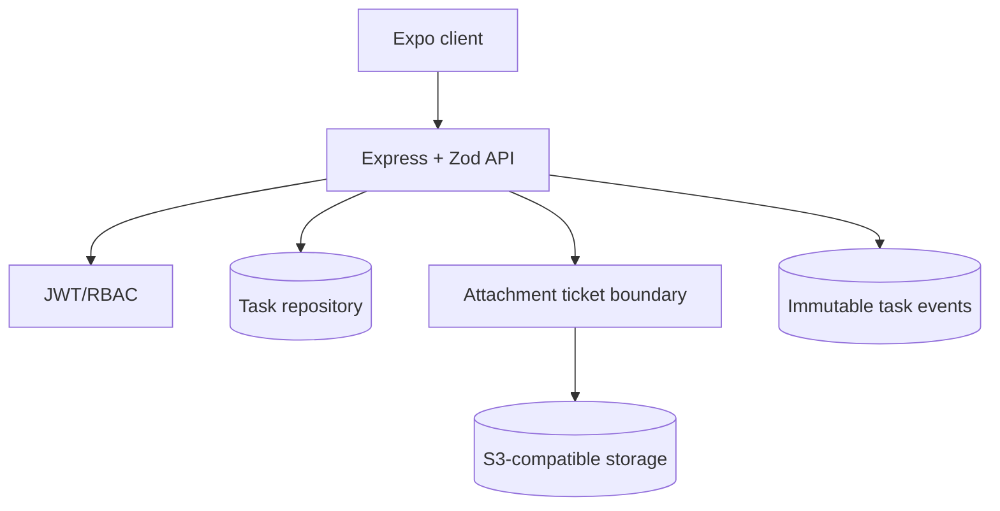
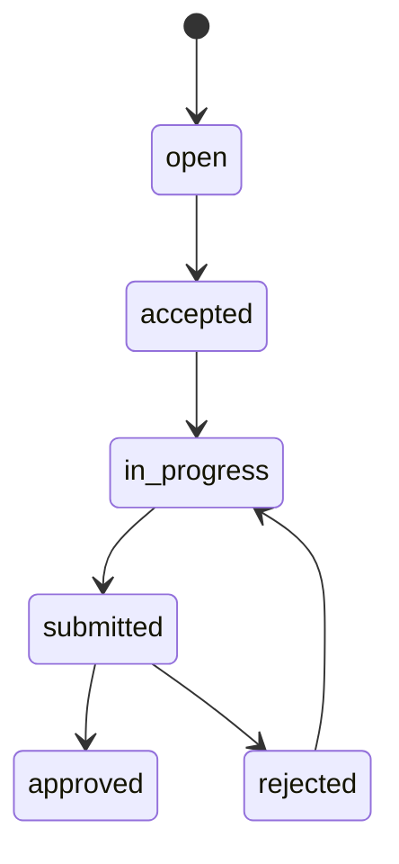

# WingOps

WingOps is a workforce task API for authenticated agents and supervisors. It models an explicit task state machine, role-aware assignment, evidence attachments, and an event timeline suitable for operational review. The service is intentionally cloud-neutral: attachment creation returns an object-store upload ticket instead of buffering media through the API.

## Architecture



## Workflow



## Structure

- `src/app.ts`: HTTP routes and state-transition policy.
- `src/security.ts`: password hashing and JWT claims.
- `src/db.ts`: local schema for tasks, attachments, and events.
- `tests/`: workflow contract test.

## Run locally

Requires Node.js 22.5 or newer because the local adapter uses the built-in `node:sqlite` module.

```bash
npm install
cp .env.example .env
npm run dev
npm test
```

## Engineering choices

The state machine is centralized at the API boundary so mobile clients cannot bypass review controls. Every change emits a durable event, which supports a future activity feed and reconciliation worker. Production hardening should add refresh-token rotation, tenant isolation, Postgres migrations, signed S3 URLs, malware scanning, and an outbox for push notifications.
