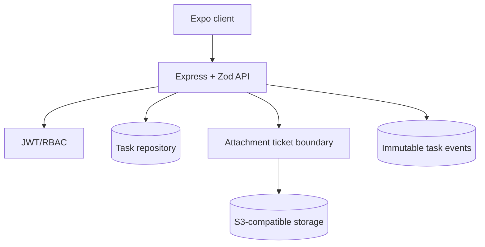
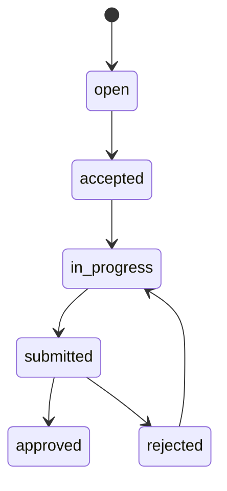

# WingOps

WingOps is a workforce task API for authenticated agents and supervisors. It models an explicit task state machine, role-aware assignment, evidence attachments, and an event timeline suitable for operational review. The service is intentionally cloud-neutral: attachment creation returns an object-store upload ticket instead of buffering media through the API.

## Architecture



## Workflow



## Structure

- `src/app.ts`: HTTP routes and state-transition policy.
- `src/security.ts`: password hashing and JWT claims.
- `src/db.ts`: local schema for tasks, attachments, and events.
- `tests/`: workflow contract test.

## Run locally

Requires Node.js 22.5 or newer because the local adapter uses the built-in `node:sqlite` module.

```bash
npm install
cp .env.example .env
npm run dev
npm test
```

## Engineering choices

The state machine is centralized at the API boundary so mobile clients cannot bypass review controls. Every change emits a durable event, which supports a future activity feed and reconciliation worker. Production hardening should add refresh-token rotation, tenant isolation, Postgres migrations, signed S3 URLs, malware scanning, and an outbox for push notifications.

## Security

Passwords are stored with `scrypt` and a random per-user salt; JWT signing requires a 32-character secret in production. Configure `CORS_ORIGINS` to the mobile/web origins you actually trust. The local development fallback secret and open-origin behavior are intentionally disabled by the production checks.

## Production adapters

Set `DB_URL` or `SUPABASE_DB_URL` to select the managed Postgres connectivity check. Because the HTTP handlers still use the synchronous SQLite repository, production startup intentionally fails fast when these variables are present unless `POSTGRES_ROUTES_ENABLED=true`; the concrete remaining task is to migrate the route repository calls to an async Postgres implementation before enabling that flag. Set `SUPABASE_URL`, `SUPABASE_SERVICE_ROLE_KEY`, and `SUPABASE_STORAGE_BUCKET` (or `STORAGE_BUCKET`) for signed uploads. The service-role key is server-only and must never be placed in the Expo client. Local tests omit these values and continue using the Node SQLite adapter.

## Managed Postgres schema

Apply sql/postgres-schema.sql to the provisioned Supabase database. It creates the wingops_users, wingops_tasks, wingops_attachments, and wingops_events tables with UUID keys, JSONB event metadata, and RLS enabled. DB_URL or SUPABASE_DB_URL selects the async repository; local tests continue to use SQLite. SUPABASE_SERVICE_ROLE_KEY is server-only.
